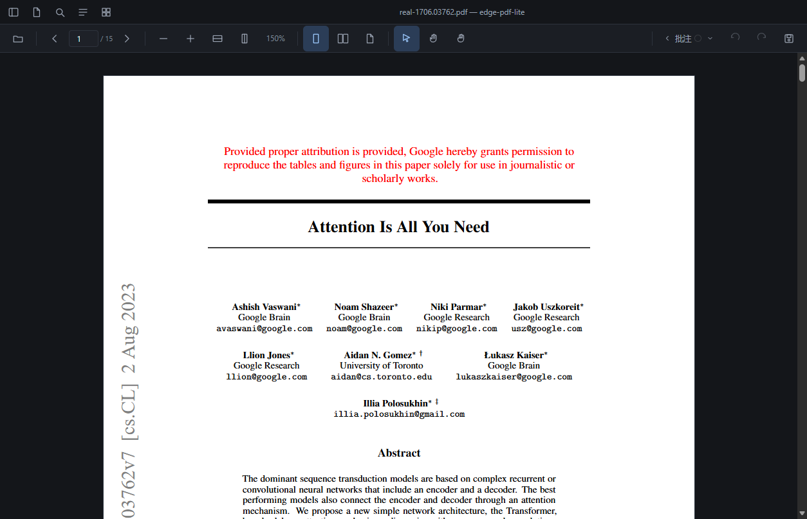
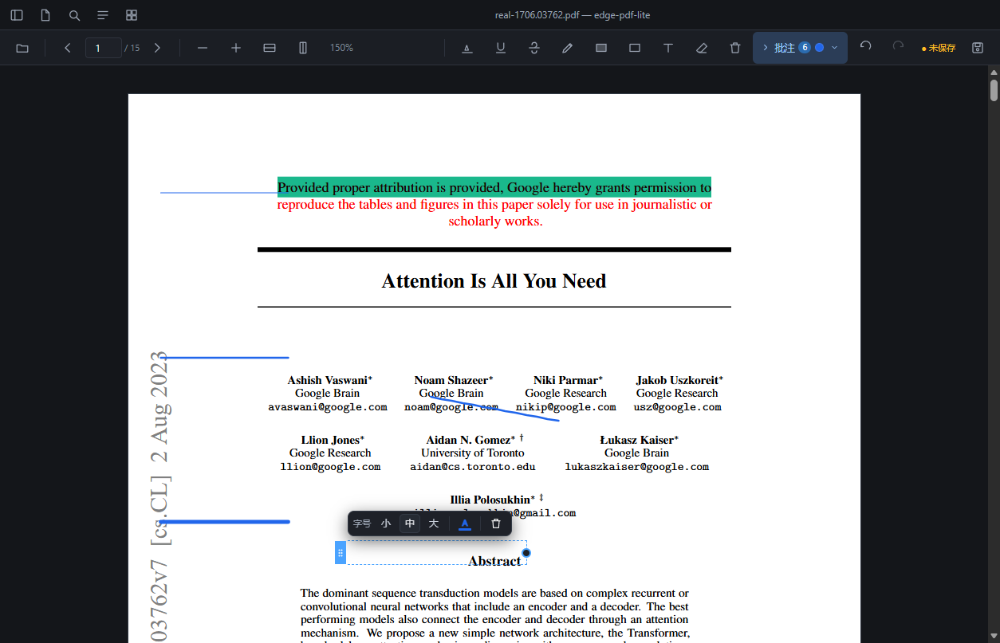

# edge-pdf-lite

[](LICENSE)
[](https://github.com/Huaji-cmd/edge-pdf-lite/releases)
[](#)
[](https://v2.tauri.app/)
[](https://vuejs.org/)
[](https://mozilla.github.io/pdf.js/)

轻量 PDF 阅读 + 批注编辑器，面向**低配 Windows**（8 GB 内存那一档）。

> **定位**：不比 Edge 差，但**只在必须付的时候付一次**；并且做 Edge 没有的几件事
> —— 双页并排、阅读位置记忆、批注写回 PDF。

> 📌 **`v1.2.0`**：长期自用后攒下的一批批注交互问题集中修复（高亮/手写锁定、区域框手柄、
> 触屏手感、文件列表刷新与展开记忆、缩略图定位、删除残影、双下划线），详见[更新日志](#更新日志)。
> 仍为**个人项目**：不接收 PR（理由见 [SECURITY.md](SECURITY.md)），Issue 可以提。



- **网页版**：浏览器里直接打开就能用。
- **桌面版**（Tauri v2）：能拿到文件真实路径，所以文件列表能记住、能覆盖原文件。

---

## 目录

- [项目状态](#项目状态)
- [更新日志](#更新日志)
- [为什么做这个](#为什么做这个)
- [功能特性](#功能特性)
- [快速开始](#快速开始)
- [常用命令](#常用命令)
- [它是怎么守住"轻量"的](#它是怎么守住轻量的)
- [已知限制](#已知限制)
- [常见问题：启动出来一个"乱码错误页"](#常见问题启动出来一个乱码错误页)
- [下载与校验（防投毒）](#下载与校验防投毒)
- [技术栈](#技术栈)
- [验证方式](#验证方式)
- [安全](#安全)
- [项目结构](#项目结构)
- [参与贡献](#参与贡献)
- [许可证](#许可证)

---

## 项目状态

| 项 | 值 |
|---|---|
| **当前版本** | [`v1.2.0`](https://github.com/Huaji-cmd/edge-pdf-lite/releases/tag/v1.2.0) |
| **仓库状态** | 已公开，**未归档**（可读、可 fork） |
| **维护** | 个人自用，按需更新；**不接收 PR**，Issue 可以提 |

这是给自己用的工具，所以更新节奏跟着"我用着别扭了"走，没有 roadmap、没有兼容性承诺。

之前归档过一段时间（`v1.1.1`），当时是试用后觉得够用了。后来自己天天用，攒下一批
交互上的毛病 —— 归档状态下改不了，于是解除归档、修完这些再发 `v1.2.0`。

仍然**不接收代码补丁**：我看不到每一行改动，收下一个自己没审过的 PR，对所有使用者都更糟。
想改请 fork（MIT 允许）—— `docs/` 里那批"为什么这么定"的推导，比代码本身更有参考价值。

---

## 更新日志

### `v1.2.0` — 批注交互修复（2026-10-19）

全是长期使用后暴露的问题，逐条都有回归用例：

| 问题 | 处理 |
|---|---|
| 高亮 / 下划线 / 删除线选中后还能拖动缩放 | 锁定为**只可选中、只能删** —— 位置由原文决定，拖一下会盖到别的句子上，肉眼很难发现 |
| 手写笔迹选中后能缩放 | 同上，一并锁定（8 个角点手柄彻底移除） |
| 区域高亮 / 方框的手柄不好用 | 改成和文本框一致的**「左边移动条 + 上/右/下三边拉伸」** |
| 触屏下文本框移动、拉伸都用不了 | 手柄声明 `touch-action: none`（`preventDefault()` 挡不住，手势开始前就得声明）；热区放大到 38×44，且视觉圆圈回到框边界上 |
| 新加文件夹 / 另存文件后列表不刷新 | 新增刷新按钮，重扫已展开目录并**复用旧节点**（不把展开层级弄塌） |
| 从大纲切回文件列表，文件夹要重新展开 | 展开状态持久化，键用**真实路径**而不是会话内自增 id |
| 打开缩略图总是从第 1 页开始 | 挂载后定位到当前页 |
| 删掉页面上**最后一条**批注，字还留在画布上 | 异步重绘抓的是删除**之前**的快照，`await` 之后才落笔把旧数据画回去；现在空列表分支也作废在途请求，且**落笔前重新取一次数据** |
| 下划线偶尔变成**两条平行线** | `getClientRects()` 把一行拆成多个高度不同的矩形；现在先按垂直重叠聚成一行，组内上下边取并集 |

### 更早的版本

| 版本 | 内容 |
|---|---|
| [`v1.1.1`](https://github.com/Huaji-cmd/edge-pdf-lite/releases/tag/v1.1.1) | 指针 / 触屏交互与回退录制的一批修正；归档前最后一版 |
| [`v1.1.0`](https://github.com/Huaji-cmd/edge-pdf-lite/releases/tag/v1.1.0) | 批注写回 PDF、就地编辑文本框 |
| [`v1.0.0`](https://github.com/Huaji-cmd/edge-pdf-lite/releases/tag/v1.0.0) | 首个可用版本：双页并排、阅读位置记忆、批注 |
| `v0.1.0` / `v0.2.0` | 早期原型（渲染管线 / 缩略图） |

---

## 为什么做这个

低配 Windows 上打开一份几十 MB、每页是一整张大图的 PDF，Edge 也会卡。但"卡"的
原因不是内核差，而是**首次打开一页要解码一整张图**——这是硬成本，谁都省不掉。

所以这个项目的目标不是"比 Edge 快"，而是：

1. **不重复付费** —— 翻回去看过的页立刻出来，滚动保持满帧；
2. **补齐 Edge 缺的** —— 双页并排、按内容指纹记住阅读位置、批注写回 PDF；
3. **严守 scope** —— 不做 OCR、不做页面操作（删页 / 合并）、不改 PDF 原有文字。

---

## 功能特性

| | 说明 |
|---|---|
| **阅读** | 单页 / 双页并排、按行翻页、缩略图、PDF 书签跳转 |
| **缩放** | 滚轮、适配宽度 / 整页、双指捏合（触屏） |
| **位置记忆** | 按文档内容指纹记住"看到第几页、多少缩放"，换台机器也认 |
| **打开记忆** | 桌面端还会记住**上次看的是哪一篇**，重开应用自动打开它（路径失效就退回欢迎页并提示） |
| **批注** | 高亮（不盖住文字）、下划线、删除线、区域高亮、手写（三档笔尖粗细）、方框、文本框 |
| **文本框** | 点页面**就地**出现编辑框（左实心条拖动、右圆圈调宽）、到框宽自动换行、字号三档 + 字体颜色；点空白处收起，文字与 PDF 融为一体 |
| **编辑** | 选中后可拖动 / 改大小 / 改颜色 / 删除，撤销 · 重做 |
| **写回 PDF** | 增量更新，写入的是**标准注释对象**（`/Highlight` `/Ink` `/FreeText`），Edge / Acrobat 都能看到 |
| **触屏** | 单指画 / 划选文字，双指平移 · 缩放（Surface 上验证过） |
| **文件列表** | 桌面端：真实路径、跨会话记住、点开文件夹才扫一层（懒加载）、右键可重命名 / 在资源管理器打开 / 复制路径 |
| **保存** | 另存到指定目录（默认文档库），或直接覆盖原文件（**自动留 `.bak`**）；保存后提示完整路径并可一键打开文件夹 |
| **外观** | 日间 / 夜间 / 跟随系统 |

就地编辑的文本框（字号三档 + 字色，写回后是标准 `/FreeText`）：



---

## 快速开始

### 直接用

下载 [Release](https://github.com/Huaji-cmd/edge-pdf-lite/releases) 里的
`edge-pdf-lite.exe`（免安装，双击即用），或安装 NSIS / MSI 安装包。

要求：Windows 10+（自带 WebView2 运行时）。

### 从源码

```bash
npm install          # postinstall 会自动拷 pdf.js 的 cmaps / 标准字体
npm run dev          # http://localhost:5173
```

想跑测试的话，先把样本备齐：

```bash
npm run testdata         # = testdata:local + 取回真实论文语料（一条命令搞定）
npm run testdata:local   # 只生成合成样本，不联网
npm run testdata:real    # 只取回真实论文语料（arXiv，约 2.2 MB）
```

`public/testdata/` 整体**不入库**：

- 合成样本（文字页 / 矢量页 / 对照实验样本）由脚本当场生成；
- 「真实论文语料」按需取回 —— 它是 arXiv 电子预印本，**没有再分发的授权**，
  放进仓库等于替别人分发。测试用它是有理由的：合成样本验证不了真实文档的页面构成
  （内嵌字体 + 整页图片 + 上百条既有注释），好几个决定性结论都只能在它上面测出来。

拿不到 arxiv.org 的时候（公司 / 校园网常见）：

```bash
EPL_REAL_PDF_URL=<镜像地址> npm run testdata:real
```

或者**直接把你手边任意一份真实 PDF 改名放过去** —— 测试不检查它的内容，
只要"有文字层、有图片"就够：

```
public/testdata/real-1706.03762.pdf
```

### 打包

```bash
npm run exe                 # 只出裸 exe（免安装）
npm run tauri -- build      # 含 MSI + NSIS 安装包
```

> Windows 上打包需要 Rust（MSVC 工具链）+ WebView2。`cargo` 不在 PATH 也能跑 ——
> `scripts/tauri.mjs` 会自己找出工具链并注入环境。

---

## 常用命令

```bash
npm run dev | build | serve:dist     # 开发 / 构建 / 生产对照
npm test                             # 八套浏览器端回归（380 项，含 CSP）
npm run test:csp                     # 只跑 CSP 那条（策略没被放宽 + 0 违规）
npm run test:exe                     # 打包后 exe 的端到端验证（60 项）
npm run test:exe:heal                # 专测 WebView2 profile 自愈（17 项）
npm run edge:shot <pdf> [页码]       # 用 Edge 内置查看器（PDFium）截图做对照
```

---

## 它是怎么守住"轻量"的

这些结论**都是实测出来的，不是推理的**（方法和数据见 `docs/M0-裁剪渲染实验结论.md`）：

| 结论 | 数据 |
|---|---|
| 滚动 | ✅ 满帧 60 fps —— **滚动本身不卡** |
| 真正的痛点 | 新页出现慢（白屏 185–409 ms），不是掉帧 |
| 首次打开一页 | 图片版 ≈334 ms；文字版 ≈99 ms |
| 重复渲染 | ✅ pdf.js 自带缓存：171 ms → 13.6 ms |
| 裁剪渲染 | ⛔ **已证伪**（图片页 0.86–0.94×）—— 解码是整张的，裁剪省不掉 |
| 加载选项 | ⛔ `enableHWA` / `useSystemFonts` / `disableFontFace` 全部 ≈1.00× |

🔴 **决定性对照**：同一本书在 Edge（C++ PDFium）里打开**同样卡** ——
所以那不是内核差距，是这台机器处理"每页一整张 4.5 MP 图片"的上限。

**能承诺**：不重复付费、滚动不卡、缩放不逐帧重渲染、Edge 没有的功能。
**不能承诺**：首次打开一页比 Edge 快（解码是硬成本）。

刻意**不做**：OCR、页面操作（删页 / 合并）、修改 PDF 原有文字 —— 这些一做就不 lite 了。

---

## 已知限制

诚实清单 —— 开源项目的信誉靠这个，藏起来只会让人踩坑后更失望。

| 限制 | 说明 |
|---|---|
| **已有的批注擦不掉** | 打开 PDF 时，文件里原有的注释**不进**编辑列表 —— 看得见，但不能擦、不能拖 |
| **中文文本框跨查看器** | 别的查看器里只显示**占位横线**（标准字体没有中文字形），**不再是白底方框**。文字没丢，在应用内和注释面板里都看得到。要真画出中文得子集化嵌入一份 CJK 字体（几 MB，与 lite 定位冲突） |
| **写回在主线程** | 20–50 MB 的文件会感觉到一下卡顿，这部分该搬到 Worker |
| **大文件增量写入未测** | 小文件上增量既不快也不小；它的价值在大文件（峰值内存），但大文件还没实测 |
| **无边框窗口** | 换来了自绘标题栏，代价是失去系统"拖到边缘自动分屏" |
| **网页版没有真实路径** | 浏览器拿不到文件路径，所以文件列表不能跨会话记住、不能覆盖原文件、**也不会自动打开上次那篇**（界面上会明确说明） |
| **位置记忆** | 按内容指纹存，同一份文件改名 / 移动都认；但文件被大改后指纹变化会丢失记忆 |

---

## 常见问题：启动出来一个"乱码错误页"

这是一个**不用重装**的问题，而且现在已经能自愈。

**现象**：双击打开，窗口里只有一行乱码（其实是 WebView2 自己画的错误页，UTF-8 中文被按 GBK 显示，
内容是「找不到 tauri.localhost 的服务器 DNS 地址」）。这不是我们界面白屏，是 WebView2 的
**虚拟主机映射**失效了 —— Tauri 把前端资源挂在 `http://tauri.localhost` 上，映射一坏，
请求就跑到真实网络去解析这个域名。

**怎么办**（按推荐顺序）：

1. **什么都不用做，直接再打开一次** —— 应用会自己发现"上次没启动成功"，把 WebView2 的
   profile 清掉重建（`%LOCALAPPDATA%\com.edge-pdf-lite.desktop\EBWebView`）。
   **你的文件列表和设置不会被清掉**（它们单独放在 `Default\Local Storage` 里）。
2. 想手动来一遍也行：把上面那个 `EBWebView` 目录整个删掉再启动。代价是文件列表 / 设置在
   `Local Storage` 里会一起没 —— 所以只在第 1 条不管用时再用。

**已经做了哪些防范**：

- **单实例保护**：第二次双击不会再开一个 WebView2 会话（两个实例抢同一个 profile 会把
  它搞坏），而是把已有窗口拉到前面。
- **启动失败的自我判定**：`setup` 里先记一笔「这次启动还没证明自己是好的」，前端跑起来后
  再用更新的一笔盖过去。所以**白屏一次，下一次启动就会自愈**。
- 自愈**只在启动前、且进程里还没有 WebView2 的时候做**（那时删文件才删得干净），
  并且会先确认没有别的实例正在用这个 profile。

---

## 下载与校验（防投毒）

exe **没有做代码签名**（签名证书要花钱，这是个人项目），所以 Windows 会弹
「Windows 已保护你的电脑 / 未知发布者」—— 点「更多信息」→「仍要运行」即可。
介意的话可以自己从源码编译。

正因为没有签名，**校验只能靠自己动手**，两步：

1. **只从本仓库的 [Releases](https://github.com/Huaji-cmd/edge-pdf-lite/releases) 页下载。**
   任何第三方站点的同名 exe 都不能当作本项目产物 —— 每个 Release 的资产自上传后就不再
   改动，所以这里永远是唯一的权威来源。
2. **下完核对 SHA256**：每个 Release 的说明里都给了三个资产的校验和，
   本地算出来比对即可：

   ```powershell
   certutil -hashfile edge-pdf-lite.exe SHA256
   ```

   或者 Git Bash 里：

   ```bash
   sha256sum edge-pdf-lite.exe
   ```

对不上就不要运行，直接删掉。

---

## 技术栈

| 层 | 选型 |
|---|---|
| 渲染 | **pdf.js 6.x**（现代构建 + 自带 ES2025 polyfill，见 `docs/在另一台机器上测试.md`） |
| 界面 | **Vue 3** `<script setup>` + TypeScript + Pinia |
| 构建 | **Vite**（rolldown 版） |
| 桌面外壳 | **Tauri v2**（Rust，WebView2） |
| PDF 写回 | **pdf-lib**（`@cantoo/pdf-lib` 分支，支持增量更新） |
| 测试 | 零框架：Node 22 内置 WebSocket + **CDP** 驱动真实浏览器 / WebView2 |

---

## 验证方式

端到端测试全部用 **CDP**（headless Edge / WebView2 的调试端口），零测试框架依赖：

- **发真实事件**（`Input.dispatchMouseEvent` / `dispatchTouchEvent`），不是直接调函数 ——
  这样能顺带验证指针捕获这类只有真实交互才暴露的问题。
- **判据要求"有牙"**：每条断言都要能抓住对应的失败。
  比如判"批注写进去了"用的是 pdf-lib 直查 `/Annots` 且要求**恰好 +1**
  （测试样本本来就带 113 条批注，写成"大于 0"的话 writer 一行不写也照样绿）。
- 新判据一律做**变异测试**：把修复注回去，确认测试真的变红，再还原。
- `npm test` 八套 380 项；`npm run test:exe` 60 项，覆盖打包后的桌面端专有能力。

---

## 安全

- **CSP 锁到 `'self'`**（`src-tauri/tauri.conf.json`）：没有 `'unsafe-inline'`、
  没有 `unsafe-eval`，`object-src` / `base-uri` / `form-action` / `frame-ancestors` 全为 `'none'`。
  这是**实测可用**的策略，不是照抄模板 —— 完整推导见 `docs/M13-打包成exe.md` 第七节。
- CSP 设错的症状**不是报错**，是"某个功能悄悄没了"（worker 被拦 → pdf.js 静默退回主线程，
  页面照常显示只是卡）。所以有独立的 `npm run test:csp`：**主动监听 `securitypolicyviolation`**，
  并断言"0 违规"同时"内容真的画上去了"，避免白屏时的假绿。
- 前端不引入任何第三方 CDN 资源，全部走本地打包。
- **文件读写只放行你亲手选过的路径**：读 / 写 / 列目录 / 重命名这几个命令都会先把路径
  `canonicalize()` 再比对白名单，范围外一律拒绝。登记只发生在 Rust 侧（前端没有"加白名单"
  的接口）—— 即使某天前端被注入脚本，它也读不到、写不进你选过的范围之外。
- **隐私清理（公开前做过一轮，你可以自己复核）**：
  - 提交作者 / 提交者邮箱统一是 `Huaji-cmd@users.noreply.github.com`（GitHub 的匿名转发地址，
    不暴露真实邮箱）；
  - 全历史（含**已删除的文件**和 **commit message**，不只当前工作区）扫过本机路径、
    邮箱、手机号、身份证、内网 IP、各类平台 token 与私钥格式 —— **真实命中 0 条**；
    文档里那些 `C:\Users\你\...` 是占位符，不是真值；
  - 复核命令（在本仓库里跑）：

    ```bash
    git log --all --format='%an <%ae>' | sort -u          # 提交身份
    git log --all --format='%cn <%ce>' | sort -u          # 提交者身份
    git log --all -p | grep -aiE 'users\\|ghp_|BEGIN [A-Z ]*PRIVATE KEY'
    ```

- 安全问题的报告方式、以及**为什么本仓库不接收代码补丁**，见 [SECURITY.md](SECURITY.md)。
  仓库不再归档、Issue 可用；但代码补丁仍然不收 —— 想改请 fork。

---

## 项目结构

```
src/
├── App.vue              主界面
├── annot/               批注：存储 / 编辑 / 几何 / 绘制 / 写回 PDF
├── pdfjs/               pdf.js 装载（自定义 worker 入口 + ES2025 polyfill）
├── viewer/              阅读器 / 工具栏 / 侧边栏各面板 / 设置
└── check/               跨查看器自检页的脚本（annot-check.html / write-check.html）
src-tauri/               Tauri v2 外壳（窗口、文件读写、对话框）
docs/                    各阶段的实验结论与决策记录（M0–M14）
scripts/                 构建、测试、样本生成
```

各阶段的完整推导在 `docs/` 里 —— 本 README 只给结论。

---

## 参与贡献

**不接收 PR**（理由见 [SECURITY.md](SECURITY.md)）。发现问题可以开 Issue 说清楚，我会自己改；
想要自己的改动，请 fork（MIT 允许）。

fork 之后继续开发的话，有两条项目约定值得留着 —— 这个项目能保持可信，靠的就是它们：

- **测试红了要真修**，不要放宽断言或改判据去迁就实现。
- **性能结论必须来自测量**，并且要有对照组；"看起来快了"不算数。

---

## 许可证

[MIT](LICENSE) —— 随便用、改、商用，保留版权声明即可。
